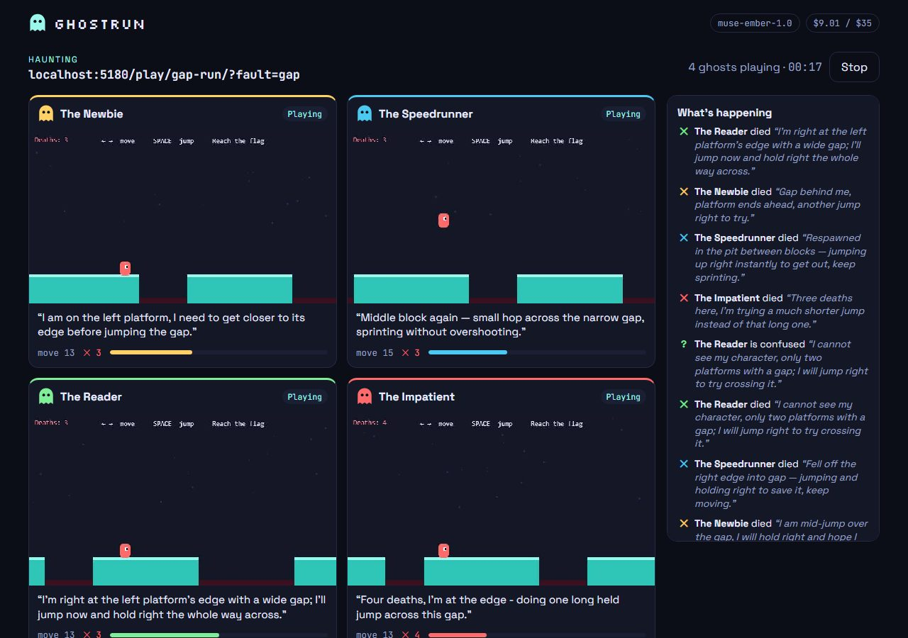
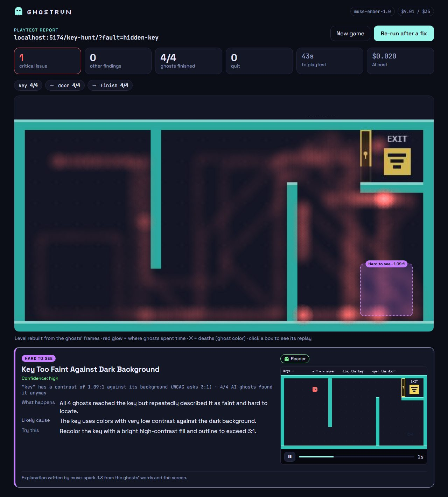
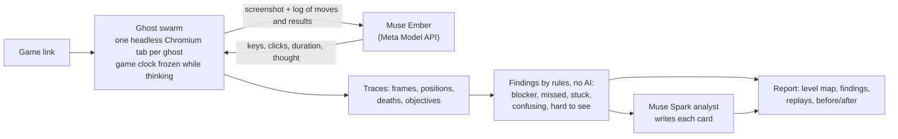

# Ghostrun

**Ghosts play your game first.** Paste your web game's link: AI ghost players with different personalities play it, think out loud, and show you exactly where real players will get stuck, before the jam deadline.



**Evidence:** [benchmark with known answers](bench/README.md) · [AI design decisions, measured](bench/README.md#experiments-on-our-ai-design-decisions) · [people vs ghosts](bench/README.md#people-vs-ghosts) · [what happens when things fail](docs/failure-handling.md) · [where a person checked the AI's work](docs/ai-review-log.md)

Built by Rafael Gálvez (solo, student) for the [Global AI Builder's Challenge](https://global-ai-builders-challenge.devpost.com/), 21–28 November 2026.

## The problem

In a game jam you build a game in 48–96 hours. Three hours before the deadline it works… for you: you know the level by heart, so you cannot see what a newcomer will not understand. Everyone else is busy with their own game, so nobody playtests yours. You ship blind, and the comments ("I didn't know what to do in level 2") arrive after the jam, when you can no longer fix anything.

It is not a small group: the GMTK Game Jam 2025 alone received [9,515 games in four days](https://itch.io/jam/gmtk-2025/entries). Studios pay for AI playtesting ([nunu.ai raised about $6M](https://gamesbeat.com/nunu-ai-raises-6m-for-ai-agents-dubbed-unembodied-minds-for-game-testing/)); jam developers, mostly students and hobbyists, have nothing.

## What Ghostrun does

1. **You paste a link.** Any web game that runs in a browser. No install, no engine plugin. A one-line SDK is optional and gives exact positions.
2. **Four AI ghosts play it at once**, each with a personality: the Newbie, the Speedrunner, the Reader, the Impatient (and the Completionist). They read the screen, decide, and say what they think. **The game clock freezes while each ghost thinks**, so they can play real-time games too.
3. **You get a report** in about a minute, for about $0.02: a map of the level rebuilt from the ghosts' screens, and each problem as a finding with its replay, the ghosts' own words and a suggested fix.
   - **Blocker**: a spot nobody got past.
   - **Missed objective**: something nobody found.
   - **Stuck**: where ghosts ended up circling.
   - **Confusing**: where they said they did not understand.
   - **Hard to see**: an objective drawn with too little contrast.
4. **You fix it and re-run**: the new report is compared with the old one ("critical issues 1 → 0, ghosts that finished 0/4 → 3/4").


## Does it work? (measured, not claimed)

Five small web games, each with a clean version and a version with one planted design flaw whose type and place we know ([benchmark](bench/README.md)). The current version, on 40 fresh runs:

| | Result |
|---|---|
| Planted flaws found (right type, right place) | **20/20** |
| Clean games with a false alarm | **0/20** |
| Ghosts that finished the clean games | **74%** |
| Cost and time per playtest (4 ghosts and the analyst) | **about $0.02, under a minute** |
| Spots where a person died or got stuck that the ghosts also flagged | **4/4** ([people vs ghosts](bench/README.md#people-vs-ghosts)) |

| Case | What happened |
|---|---|
| Normal: Gap Run, one gap too wide to jump | Blocker at that gap in 4/4 runs |
| Normal: Key Hunt, key drawn in the floor colour | "Hard to see" (contrast 1.09:1) in 4/4 runs |
| Repeat: the same 10 variants, a second fresh round | 10/10 flaws and 0/10 false alarms again |
| Hard: [NILO](games/third-party/nilo/README.md), a real jam game we did not make, unmodified, no SDK | The ghosts got through its mouse-only menu by themselves, and all four got stuck at the start of level 1. A person confirmed half the diagnosis: the controls are confusing, but the jump was not too hard ([partial success](bench/README.md#hard-case-a-real-jam-game-we-did-not-make)) |



## How the AI is used

**In the product** (all through the [Meta Model API](https://dev.meta.ai/docs)):

- **The ghosts: `muse-ember-1.0`**, reasoning effort `minimal`. Each move, a ghost receives the screenshot and a log of its earlier moves with what each one did ("→ you moved 126 px right and 60 px up", "→ you died"). It answers with structured JSON: keys to hold, keys to tap, clicks, how long, what it saw, where it is, and a thought in character.
  - **Why Ember**: on the same benchmark, Muse Spark and Muse Wonder found the same flaws and did not play better. They cost 11–17× more and decided about 3× slower ([model comparison](bench/README.md#which-model-should-the-ghosts-use-meta-model-api)).
- **The analyst: `muse-spark-1.3`**, reasoning `minimal`, writes the card for each finding (title, what happens, likely cause, suggested fix, confidence, and whether the ghosts' own clumsiness could explain it). It only explains findings it is given.
- **What does not use AI.** The findings themselves come from plain rules over what the game reports (deaths, objectives, positions) and over the screen (contrast), so the AI cannot invent a problem.

**Decisions we made and measured** ([details](bench/README.md#experiments-on-our-ai-design-decisions)):

| Decision | Without it | With it |
|---|---|---|
| **Bullet time**: freeze the game clock while the model thinks | 62% of deaths happened while the AI was still deciding; 0/8 ghosts finished the timing-heavy Read Me | 0 by design; 6/8 finished |
| **Tell the ghost what each move did** (a person sees their character move and die; a ghost only gets one screenshot per turn) | 60% of ghosts finished the clean games | 74%, with 30% fewer deaths |
| **Measure the contrast of objectives** (AI eyes saw a 1.09:1 key that a person could barely see) | The faint-key flaw was missed 4/4 | Found 4/4, no new false alarm when 90 recorded runs (45 of them clean) were re-scored |
| **Prompt built for Meta's prompt cache**: stable part first, append-only move log, a shared `prompt_cache_key` | 48% of the input served from cache | 70% (cached input costs 25× less) |
| **Stop a ghost once it has shown enough** (8 deaths at one spot, or 20 moves without new ground) | — | 15% fewer moves on replayed runs, same flaws found |

Together, these made a run 17% cheaper for the ghosts and the analyst's cards 47% cheaper, about 30% less per playtest. We also report what we rejected: smaller screenshots (8% cheaper, worse perception), not asking the ghost for its position (13% cheaper, but twice the deaths next to hazards), shorter memory, stricter stops ([tried and rejected](bench/README.md#cheaper-and-better-ghosts)).

**In development.** Ghostrun was built with heavy AI assistance: Claude Code wrote most of the code and documentation under Rafael's direction, and Claude subagents built four of the five test games. Where a person checked AI-made work, what was found and what changed is logged in the [AI review log](docs/ai-review-log.md). For example, a person's review of a real game (R5) showed that a card blamed a platform that was easy to reach, so every card now states its confidence and whether ghost skill could explain it.

## How it is built



- **Node.js server** (`src/server.mjs`) that runs the playtests, streams them live to the browser (Server-Sent Events), queues them, and serves the app and the test games (`/play/`).
- **Playwright + Chromium** for the ghosts; Playwright's fake clock implements bullet time (`src/ghost.mjs`).
- **React + Vite** web app (`web/`).
- **Optional SDK** (`games/sdk/ghost-sdk.js`), a few lines in your game for exact positions, deaths and objectives. Without it the ghosts report what they see on screen, and the map is approximate:

  ```js
  ghost.world(levelWidth, levelHeight);                   // once
  ghost.state({ milestones: [{ name: 'key', x: 568, y: 296, kind: 'object' }] });
  ghost.pos(player.x, player.y);                          // every frame
  ghost.event('death');                                   // when the player dies
  ghost.event('milestone', { name: 'key' });              // objectives
  ghost.event('win');
  ```

## Run it locally

Needs Node.js 22+ and a [Meta Model API](https://dev.meta.ai) key.

```bash
git clone https://github.com/Ruby570bocadito/ghostrun.git
cd ghostrun
npm install
npx playwright install chromium
cp .env.example .env        # then put your key in MODEL_API_KEY
npm run build
npm start                   # http://localhost:5180
```

Then pick "No game handy? Try ours" on the home page, or paste any web game's link. The test games are also playable by people at <http://localhost:5180/play/>.

- `npm test`: 32 tests (analysis, ghost feedback, failure handling, public-demo protections), no API key needed.
- `npm run bench -- --label mine --reps 2`: the benchmark (about $0.30 with Ember).
- Public deployment (Docker, protections for strangers' links): [docs/deploy.md](docs/deploy.md).

## What is real and what is not

- **Real:** the ghosts play in real browsers with real model calls; nothing in a run is scripted. Costs come from the usage Meta reports, cached tokens included.
- **Ours:** the five test games and their planted flaws, so results can be checked against a known answer. They were written with AI help and checked by a person (reviews R1–R2). NILO is a real third-party game, unmodified.
- **Simulated, and labelled:** the "simulate an AI outage" test option, which shows the switch to a backup model. It is off in the public demo.
- **Small samples:** 2 repetitions per variant per round. The people-vs-ghosts comparison so far is one person (the developer), who had already seen the planted flaws. A blind test with new players is next.

## Limits (when to trust it, and when not)

- Ghosts are **clumsier than people at precise jumps and timing**, and weak in mazes (13% finish the clean Spike Maze). Read "stuck" and "friction" findings together with the card's confidence and its "could be ghost skill" flag.
- Ghosts **see faint shapes better than people**. Objectives the game declares are measured for contrast instead; undeclared ones are not.
- They cannot tell intended difficulty from bad design. They show where players struggle; you decide.
- Without the SDK, positions are what the ghosts report on screen, so in scrolling games the map is approximate.

More in [the benchmark's limitations](bench/README.md#limitations).

## What's next

- Public demo (ready to deploy: [docs/deploy.md](docs/deploy.md)) and a blind test with people who have never seen the games.
- More genres: point-and-click, puzzle, mobile-size games.
- Run the ghosts on every build (CI), and a local model option for unreleased games.

## Credits and third-party services

- [Meta Model API](https://dev.meta.ai): Muse Ember 1.0 and Muse Spark 1.3. Called through the [OpenAI Node SDK](https://github.com/openai/openai-node) (Apache-2.0), because the API is OpenAI-compatible.
- [Playwright](https://playwright.dev) with Chromium (Apache-2.0).
- [React](https://react.dev) and [Vite](https://vite.dev) (MIT).
- [Phaser 3](https://phaser.io) (MIT), for the test games.
- Fonts from Google Fonts (SIL Open Font License): Space Grotesk, JetBrains Mono, Silkscreen.
- [NILO](games/third-party/nilo/README.md) by Rojen Maharjan, js13kGames 2020 (MIT).

## License

[MIT](LICENSE) © Rafael Gálvez
