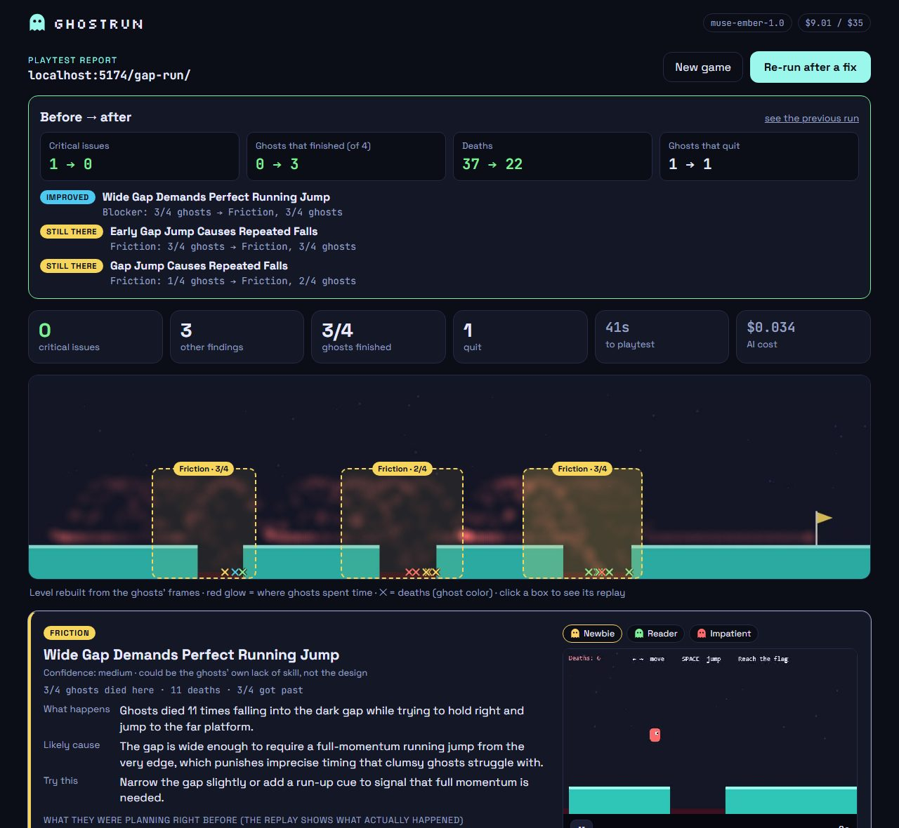
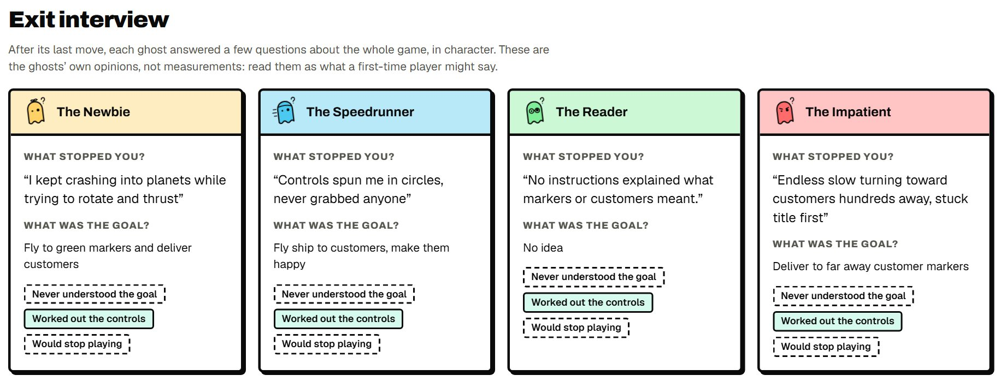
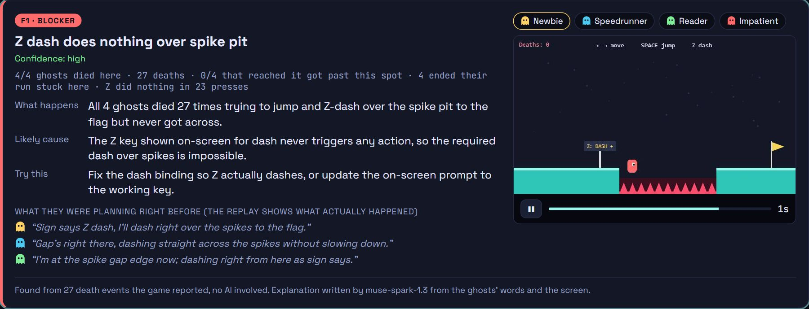
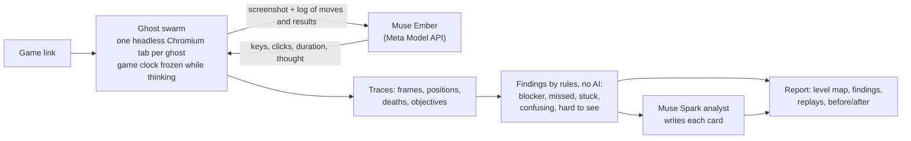

# Ghostrun

**Ghosts play your game first.** Paste your web game's link: AI ghost players with different personalities play it, think out loud, and show you exactly where real players will get stuck, before the jam deadline.


**Evidence:** [benchmark with known answers](bench/README.md) · [AI design decisions, measured](bench/README.md#experiments-on-our-ai-design-decisions) · [people vs ghosts](bench/README.md#people-vs-ghosts) · [what happens when things fail](docs/failure-handling.md) · [where a person checked the AI's work](docs/ai-review-log.md)

**Try it without installing anything:** [free demo with 9 real playtests, recorded](https://huggingface.co/spaces/Ruby570/ghostrun) (reports, replays and before/after; new playtests need the app and your own API key).

Built by Rafael Gálvez (solo, student) for the [Global AI Builder's Challenge](https://global-ai-builders-challenge.devpost.com/), 21–28 November 2026.

## The problem

In a game jam you build a game in 48–96 hours. Three hours before the deadline it works… for you: you know the level by heart, so you cannot see what a newcomer will not understand. Everyone else is busy with their own game, so nobody playtests yours. You ship blind, and the comments ("I didn't know what to do in level 2") arrive after the jam, when you can no longer fix anything.

It is not a small group: the GMTK Game Jam 2025 alone received [more than 9,500 games in four days](https://itch.io/jam/gmtk-2025/entries). Studios pay for AI playtesting ([nunu.ai raised about $6M](https://gamesbeat.com/nunu-ai-raises-6m-for-ai-agents-dubbed-unembodied-minds-for-game-testing/)); jam developers, mostly students and hobbyists, have nothing.

## What Ghostrun does

1. **You paste a link.** Any web game that runs in a browser. No install, no engine plugin. A one-line SDK is optional and gives exact positions.
2. **Four AI ghosts play it at once**, each with a personality: the Newbie, the Speedrunner, the Reader, the Impatient (and the Completionist). They read the screen, decide, and say what they think. **The game clock freezes while each ghost thinks**, so they can play real-time games too.
3. **You get a report** in about a minute, for about $0.02: a map of the level rebuilt from the ghosts' screens, and each problem as a finding with its replay, the ghosts' own words and a suggested fix.
   - **Blocker**: a spot nobody got past.
   - **Missed objective**: something nobody found.
   - **Stuck**: where ghosts ended up circling.
   - **Confusing**: where they said they did not understand.
   - **Hard to see**: an objective drawn with too little contrast.
   - **Exit interview**: after playing, each ghost says whether it understood the goal and the controls, and what stopped it most. If half or more never worked out the goal, the verdict says so.
4. **You fix it and re-run**: the new report is compared with the old one ("critical issues 1 → 0, ghosts that finished 0/4 → 3/4").



## Does it work? (measured, not claimed)

Five small web games, each with a clean version and a version with one planted design flaw whose type and place we know ([benchmark](bench/README.md)). The first version of the games was played in five rounds of 20 runs; we changed the scoring and analysis rules after looking at its first two rounds, so its honest test is rounds 3 to 5, played afterwards and not used to tune those rules. On 22–23 November we redrew all five games with one art kit, so that each flaw reads as a design flaw, and changed how the ghosts jump ([why](bench/README.md#ghosts-that-play-with-their-heads-criteria-written-before-measuring-22-nov)); new art changes what the ghosts see, so we played three new rounds with the rules unchanged.

| | New games and ghosts: 3 rounds (23 Nov) | First games: rounds 3–5 (held out) | First games: all five rounds |
|---|---|---|---|
| Planted flaws found: a critical finding of the right type in the right place | **27/30** | **26/30** | 44/50 (34 from what the ghosts did, 10 from the contrast measurement) |
| Clean games with a false alarm: the same kind of finding where there is no flaw | **1/30** | **0/30** | 0/50 |
| Clean games where the report still shows a hard spot ("friction": ghosts died there but got past; counted neither way) | 18/30 | 17/30 | 29/50 |
| Ghosts that finished the clean games | 78% | 75% | 75% |

On the new games, the three misses and the false alarm are all in Spike Maze: its clean version is a maze almost no ghost finishes (2 of 24), so in one run the ghosts that ended stuck in it made a false alarm, and its invisible spikes were twice reported as a missed objective instead of a blocker. The other four games: 24/24 found, 0/24 false alarms ([details](bench/README.md#new-art-for-the-five-games-three-new-rounds-23-nov)).

After the ghosts were rebuilt to play real games for minutes (24 November), the same benchmark in three more rounds: **26/30** found, **2/30** false alarms, 73–78% of ghosts finishing the clean games. Again every miss and false alarm is in Spike Maze; the other four games stay at 24/24 and 0/24 ([round 1](bench/results/v3-a.md), [2](bench/results/v3-b.md), [3](bench/results/v3-c.md)).

- **Cost and time per playtest** (4 ghosts and the analyst): about $0.02 and under a minute on these games (about 45 s on average; the maze takes about a minute). On real jam games, where each ghost plays 2:30 of the game, a playtest costs about $0.03–0.11 and takes 2–5 minutes ([measurement](bench/results/real-v3-speed.md)).
- **People vs ghosts:** every spot where a person died or got stuck was also flagged by the ghosts, 4/4 (2 of them only as friction). One person, the developer, not blind ([details](bench/README.md#people-vs-ghosts)).

One rule decides "found" and "false alarm", so neither can be bought with the other: only critical findings count. "Friction" counts neither way, because it also shows up on clean games at hard but fair spots, and the report labels it as probably fair. On the first games, the misses are Spike Maze's invisible spikes, which the ghosts sometimes reported only as friction (one run in most rounds, both runs in round 4). Decided after looking at the first two rounds: counting only critical findings ([why](bench/README.md#the-scoring-rule-we-changed-after-a-review)), the contrast check with our own 1.5:1 line for "practically invisible" (the faint key measures 1.09:1), and treating the deaths at both edges of one wide gap as one spot. With so few runs the uncertainty is wide: on the new games 27/30 means 74–97% and 1/30 false alarms at most 17%; on the first games 26/30 means 70–95% and 0/30 at most 11%, and over all 50, 76–94% and at most 7% (95% intervals).

| Case | What happened |
|---|---|
| Normal: Gap Run, one gap too wide to jump | Blocker at that gap in 10/10 runs (five rounds) |
| Normal: Key Hunt, key drawn in the floor colour | "Hard to see" (contrast 1.09:1) in 10/10 runs |
| Repeat: the same 10 variants, played in five separate rounds | 9/10 flaws in four rounds and 8/10 in one, with 0/10 false alarms in every round |
| Hard: [NILO](games/third-party/nilo/README.md), a real jam game we did not make, unmodified, no SDK | The ghosts got through its mouse-only menu by themselves, and all four got stuck at the start of level 1. A person confirmed half the diagnosis: the controls are confusing, but the jump was not too hard ([partial success](bench/README.md#hard-case-a-real-jam-game-we-did-not-make)) |
| Harder: 9 more real jam games by other people (js13kGames), no SDK, compared with what their players wrote | Judged blind by an independent agent: with the exit interview, the report raised the players' complaint in 5 of 9 games (1 match, 4 partial) and never came back empty; without it, 4 of 9 and 2 of 9 in two runs ([table](bench/results/outside-games.md#three-runs-judged-blind)). The games also exposed five Ghostrun bugs, now fixed |
| Real games, played for minutes: 13 jam games by other people (js13kGames and itch.io, some made with engines), no SDK, measured without AI on the recorded runs | Before 23 November a ghost played a median of 21–29 s of each game, and on two itch.io games no ghost ever got past the start screens. On 24 November each ghost played a median of 151 s of game time, with 2–5× more different screens seen; the ghosts reached the game in 11 of 12 games, and in the 13th (Decogear) all four did after a fix the same day; a run took a median of 195 s on js13k games and 243 s on itch.io games, and no ghost ended in an error. The first frame of an itch.io game came after a median of 19 s; that evening, with WebGL drawn through Vulkan, 15 s (Broken Repair 8 s, Prerolled 15 s, Decogear 31 s: alone, its own start-up takes 13 s on our PC) ([measurement](bench/results/real-v3-vulkan.md)). Not met: on the two mouse games 49% of the moves use the mouse ([measurement](bench/results/real-v3-speed.md)) |




## How the AI is used

**In the product** (all through the [Meta Model API](https://dev.meta.ai/docs)):

- **The ghosts: `muse-ember-1.0`**, reasoning effort `minimal`. Each move, a ghost receives the screenshot and a log of its earlier moves with what each one did ("→ you moved 126 px right and 60 px up", "→ you died"). It answers with structured JSON: keys to hold, keys to tap, clicks, how long, what it saw, where it is, and a thought in character.
  - **Why Ember**: on the same benchmark, Muse Spark and Muse Wonder found the same flaws and did not play better. They cost 11–17× more and decided about 3× slower ([model comparison](bench/README.md#which-model-should-the-ghosts-use-meta-model-api)).
- **The analyst: `muse-spark-1.3`**, reasoning `minimal`, writes the card for each finding (title, what happens, likely cause, suggested fix, confidence, and whether the ghosts' own clumsiness could explain it). It only explains findings it is given.
- **The exit interview: the same model and conversation**, one more call per ghost after its last move (+3.5% cost): what it thinks the goal is, whether it understood the goal and the controls, what stopped it most, whether it would keep playing. The report shows it as the ghosts' opinion, not as a finding.
- **What does not use AI.** The findings themselves come from plain rules over what the game reports (deaths, objectives, positions) and over the screen (contrast), so the AI cannot invent a problem. So does the check of which keys did anything: from the game's own state, a key the ghosts pressed again and again that never changed anything ("Z did nothing in 23 presses") goes on the card and to the analyst.

**Decisions we made and measured** ([details](bench/README.md#experiments-on-our-ai-design-decisions)):

| Decision | Without it | With it |
|---|---|---|
| **Bullet time**: freeze the game clock while the model thinks | 62% of deaths happened while the AI was still deciding; 0/8 ghosts finished the timing-heavy Read Me | 0 by design; 6/8 finished |
| **Tell the ghost what each move did** (a person sees their character move and die; a ghost only gets one screenshot per turn) | 60% of ghosts finished the clean games | 74%, with 30% fewer deaths |
| **Measure the contrast of objectives** (AI eyes saw a 1.09:1 key that a person could barely see) | The faint-key flaw was missed 4/4 | Found 4/4, no new false alarm when 90 recorded runs (45 of them clean) were re-scored |
| **Prompt built for Meta's prompt cache**: stable part first, append-only move log, a shared `prompt_cache_key` | 48% of the input served from cache | 70% (cached input costs 25× less) |
| **Stop a ghost once it has shown enough** (8 deaths at one spot, or 20 moves without new ground) | — | 15% fewer moves on replayed runs, same flaws found |
| **Measure which keys did anything** and tell the analyst (no AI) | The analyst named Read Me's real flaw (the instructions name a key that does nothing) in 6 of 12 cards | 6 of 6, with the gap cards still 7 of 7 (not held out: designed after reading those cards) |
| **Ask the ghosts afterwards** (exit interview) | On nine real jam games, the report raised the players' complaint in 4 of 9 and 2 of 9 (two runs); in 3 games of the second run it came back empty | 5 of 9, never empty (judged blind; one run per version); +3.5% cost |
| **Teach the ghost how its actions work**: a tap happens at the start of the move, so walk to the edge first and jump next; in a new game, try one key at a time (from an analysis of 5,761 recorded moves) | 16 deaths per clean Gap Run run: 69% of deaths at fair gaps were jumps started too early | 5 per run, the same flaws found (17/20) and no false alarm (0/20), for 4% more cost |
| **Play for time, not moves** (2:30 of game per ghost), with an autopilot that waits out loading screens and tries the usual start keys, no AI | On 13 real jam games, 40 moves were a median of 21–29 s of play; on Decogear 94% of the moves went on loading, credits, an intro and a name screen | A median of 151 s of play per ghost, 2–5× more different screens seen |
| **Tell the ghost what the screen did**, no AI: where it changed, whether the view scrolled (the character moved even if it stays in the middle), and which inputs have made the screen answer | 1.6 false "nothing happened" thoughts per 100 moves: the camera moved with the character | 0.2 (−87%) |
| **More game per look** (games without the SDK): actions up to 3 s and up to two more chained, short only near danger or when aiming | 27 of 28 ghosts used up their 120 model calls before 2:30 of play (each call moved the game on 0.4–0.8 s) | A median of 65 calls for 151 s; on the 9 games measured both ways, a run went from 274 to 227 s |
| **Draw a heavy game like a slower computer** (fewer frames, still frozen while the ghost thinks), real time only as a last resort, and a brake inside each move that a single stall does not trigger | In real time the game runs on while the model thinks and each screenshot waits for a busy page; one Decogear run took 32 minutes, stuck inside single moves | No run hangs. On Decogear the four ghosts play 110–121 s with the clock frozen, in a 276 s run (a run of the same day that played 2:30 in 168 s had gone to real time: the brake took the game's start-up for a hang) |
| **Draw WebGL through Vulkan** (on Windows, when it runs on a real GPU) and **read an itch.io page as text** to find its game | With four ghosts an itch.io engine game showed its first frame after a median of 19 s: the games compiled their shaders through Direct3D 11, and opening the page in a browser also started the game | A median of 15 s (Broken Repair 16 → 8 s, Prerolled 27 → 15 s); on Prerolled each ghost played 2:30 with the clock frozen instead of 112–120 s ([measurement](bench/results/real-v3-vulkan.md)) |



Together, these made a run 17% cheaper for the ghosts and the analyst's cards 47% cheaper, about 25% less per playtest. We also report what we rejected: smaller screenshots (8% cheaper, worse perception), not asking the ghost for its position (13% cheaper, but twice the deaths next to hazards), shorter memory, stricter stops ([tried and rejected](bench/README.md#cheaper-and-better-ghosts)).

**In development.** Ghostrun was built with heavy AI assistance: Claude Code wrote most of the code and documentation under Rafael's direction, and Claude subagents built four of the five test games. The ghost characters and the two illustrations in the interface were drawn with Meta's image model (`muse-image-1.0`), in a style Rafael chose from five sketches. Where a person checked AI-made work, what was found and what changed is logged in the [AI review log](docs/ai-review-log.md). For example, a person's review of a real game (R5) showed that a card blamed a platform that was easy to reach, so every card now states its confidence and whether ghost skill could explain it.

## How it is built



- **Node.js server** (`src/server.mjs`) that runs the playtests, streams them live to the browser (Server-Sent Events), queues them, and serves the app and the test games (`/play/`).
- **Playwright + Chromium** for the ghosts; Playwright's fake clock implements bullet time (`src/ghost.mjs`).
- **React + Vite** web app (`web/`).
- **Optional SDK** (`games/sdk/ghost-sdk.js`), a few lines in your game for exact positions, deaths and objectives. Without it the ghosts report what they see on screen, and the map is approximate:

  ```js
  ghost.world(levelWidth, levelHeight);                   // once
  ghost.state({ milestones: [{ name: 'key', x: 568, y: 296, kind: 'object' }] });
  ghost.pos(player.x, player.y);                          // every frame
  ghost.event('death');                                   // when the player dies
  ghost.event('milestone', { name: 'key' });              // objectives
  ghost.event('win');
  ```

## Run it locally

Needs Node.js 22+ and a [Meta Model API](https://dev.meta.ai) key.

```bash
git clone https://github.com/Ruby570bocadito/ghostrun.git
cd ghostrun
npm install
npx playwright install chromium
cp .env.example .env        # then put your key in MODEL_API_KEY
npm run build
npm start                   # http://localhost:5180
```

On Windows, `npm run local` does the build and starts the server in that terminal, asking for the key without saving it anywhere.

Then pick "No game handy? Try ours" on the home page, or paste any web game's link (itch.io pages work: the ghosts open the game inside them). The test games are also playable by people at <http://localhost:5180/play/>: every version "as designed" can be finished; the versions with a planted flaw have one design flaw on purpose, and Gap Run's cannot be finished at all.

- `npm test`: 80 tests (analysis, ghost feedback, failure handling, public-demo protections), no API key needed.
- `npm run bench -- --label mine --reps 2`: the benchmark (about $0.30 with Ember).
- Public deployment (Docker, protections for strangers' links): [docs/deploy.md](docs/deploy.md).

## What is real and what is not

- **Real:** the ghosts play in real browsers with real model calls; nothing in a run is scripted. Costs come from the usage Meta reports, cached tokens included.
- **Ours:** the five test games and their planted flaws, so results can be checked against a known answer. They were written with AI help and checked by a person (reviews R1–R2). NILO is a real third-party game, unmodified.
- **AI-generated art:** the five ghost characters and the two illustrations (error and all-clear) were made with Muse Image. The screenshots in this README and in the reports are real.
- **Simulated, and labelled:** the "simulate an AI outage" test option, which shows the switch to a backup model. It is off in the public demo.
- **Small samples:** 2 repetitions per variant per round. The people-vs-ghosts comparison so far is one person (the developer), who had already seen the planted flaws. A blind test with new players is next.

## Limits (when to trust it, and when not)

- Ghosts are **clumsier than people at precise jumps and timing**, and weak in mazes (13% finish the clean Spike Maze). Read "stuck" and "friction" findings together with the card's confidence and its "could be ghost skill" flag.
- Ghosts **see faint shapes better than people**. Objectives the game declares are measured for contrast instead; undeclared ones are not.
- They cannot tell intended difficulty from bad design. They show where players struggle; you decide.
- Without the SDK, positions are what the ghosts report on screen, so in scrolling games the map is approximate.
- **On games without the SDK, findings are leads, not verdicts.** On nine real jam games, the reports raised what players wrote in 5 of 9 at best (judged blind), and in two games they claimed problems that players contradict ([table](bench/results/outside-games.md#three-runs-judged-blind)). With the SDK (our benchmark), they found 44 of 50 planted flaws with no false alarm.
- **The exit interview is the ghosts' opinion.** It tells our clean test games (8 of 8 ghosts understood the goal) from unfamiliar jam games (half or more did not, in 7 of 9), but it is not a measurement.
- **The written cause on a card is the least reliable part.** On recorded runs the analyst explained the too-wide gap correctly in 14 of 14 cards, but found the real cause of Read Me's flaw (instructions that name the wrong key) in only 6 of 12. Once Ghostrun measured which keys did anything (no AI) and gave it to the analyst, it named the dead Z key in 6 of 6, with the gap still 7 of 7 ([every card](bench/results/analyst-blockers.md)). That fix was designed after seeing those cards, so it is not a held-out result: trust the place, the numbers and the replay first, and read the cause as a guess to check.

More in [the benchmark's limitations](bench/README.md#limitations).

## What's next

- A live public demo where anyone can start a playtest (ready to deploy: [docs/deploy.md](docs/deploy.md); today the [free demo](https://huggingface.co/spaces/Ruby570/ghostrun) shows recorded runs) and a blind test with people who have never seen the games.
- More genres: point-and-click, puzzle, mobile-size games.
- Run the ghosts on every build (CI), and a local model option for unreleased games.

## Credits and third-party services

- [Meta Model API](https://dev.meta.ai): Muse Ember 1.0 and Muse Spark 1.3. Called through the [OpenAI Node SDK](https://github.com/openai/openai-node) (Apache-2.0), because the API is OpenAI-compatible.
- [Playwright](https://playwright.dev) with Chromium (Apache-2.0).
- [React](https://react.dev) and [Vite](https://vite.dev) (MIT).
- [Phaser 3](https://phaser.io) (MIT), for the test games.
- Fonts from Google Fonts (SIL Open Font License): Space Grotesk, JetBrains Mono, Silkscreen.
- [NILO](games/third-party/nilo/README.md) by Rojen Maharjan, js13kGames 2020 (MIT).

## License

[MIT](LICENSE) © Rafael Gálvez
